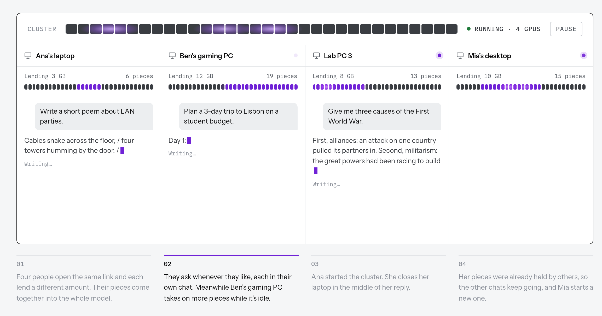
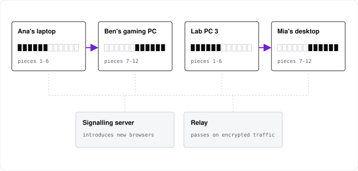

<div align="center">


# ClusterChat

**The AI your group runs together.**<br />
Cluster the graphics cards you already have to run a 27B model in the browser.<br />
Everyone gets their own chat, several replies run at once, and anyone can leave without breaking it.

[](https://clusterchat.io/chat)
[](LICENSE)
[](docs/model.md)
[](docs/architecture.md)
[](#what-it-can-run)

[**Start a private cluster**](https://clusterchat.io/create) ·
[**Try it now**](https://clusterchat.io/chat) ·
[How it works](#how-it-works) ·
[How it compares](#how-it-compares) ·
[Docs](#documentation)

<br />

| [**12 people**](#several-people-at-once) | [**19.7 tok/s**](#one-reply-at-a-time) | [**6 tok/s**](#one-reply-at-a-time) | **0 installs** |
|:-:|:-:|:-:|:-:|
| chatting at once on two RTX 3090s | two RTX 3090s, one machine | two RTX 3090s, across the internet | a browser tab |

<br />



</div>

## Why ClusterChat

A 27B model needs about 27 GB of GPU memory. Few people have that. A group
of friends, a lab or a club usually does, spread over several machines.
ClusterChat turns those machines into one model that the whole group uses at
the same time. It works like a torrent, except people share the work of
running a model instead of the pieces of a file.

- **Built for many people at once.** Everyone gets their own chat, saved in
  their own browser. One cluster writes several replies at the same time,
  each with its own KV cache on every machine, for up to 64 people. In a test
  with twelve people on two RTX 3090s, 32 of 33 replies finished
  ([numbers](#several-people-at-once)).
- **Nobody has to stay.** There is no host. Each piece of the model can be
  held by more than one browser. When someone leaves mid-reply, the browser
  before them replays the lost work into another holder, and the reply
  carries on.
- **Built for real networks.** Speculative decoding (prompt lookup plus the
  model's own multi-token prediction head) checks up to 7 tokens per trip
  around the cluster. Two machines 81 ms apart reach 6 tok/s at default
  settings and 11.7 on repetitive text.
- **Full 8-bit weights, same text however it is split.** The model runs at q8.
  The residual stream is rounded to f16 after every block, so a reply is
  bit-identical whether one browser or ten hold the model.
- **Private by design.** Invite codes live in the link's fragment and never
  reach the server. Every handshake is signed with a key derived from the
  code. Links go through a relay, so nobody learns anyone else's IP address.
- **Nothing to install.** Open a link. A new browser serves as soon as its
  first piece has downloaded and takes on more while it is idle, up to the
  VRAM limit its owner sets. Any browser can join just to chat.

> [!NOTE]
> **Your chat is separate, not secret.** Every computer in your cluster
> processes it. Invite people you trust. The public demo is open to anyone, so
> don't send it anything personal.

## At a glance

| | |
|---|---|
| **Model** | Qwen3.8-27B, 8-bit, about 27 GiB across the cluster |
| **Speed** | see [Performance](#performance) |
| **Context** | 4K to 32K tokens, chosen when the cluster is created (16K by default); the KV cache is int8 |
| **Replies at once** | set by whoever starts the cluster |
| **Chats each browser keeps in memory** | 8 by default, up to 32 in a private cluster |
| **People per cluster** | up to 64 |
| **Install** | none: a browser tab |

## How it compares

Projects that split a model across machines, or run one in a browser tab.
Each published speed is for a different model on different hardware, so read
it as what each project can do, not as a ranking. Facts are from each
project's README or the linked source as of October 2026.

| Project | Runs in | Splits one model across machines | Install per machine | Several people at once | When a machine leaves | Published speed (source, hardware) |
|---|---|---|---|---|---|---|
| **ClusterChat** | browser tab (WebGPU) | yes, over WebRTC through a relay | none, open a link | yes, each person has their own chat, and several replies run at once | pieces are held by more than one browser; an interrupted reply is replayed elsewhere | Qwen3.8-27B q8: 19.7 tok/s on two RTX 3090s in one machine, 6.0 across two machines 81 ms apart ([Performance](#performance)) |
| [Pooled](https://github.com/Nehanth/pooled) | browser tab (WebGPU) | yes, over direct WebRTC, relay as a fallback | none, open a link | one shared conversation that everyone in the room sees; requests run one at a time | the host deals the layers out again | Qwen 3.8 27B Q4_0: 20 to 27 tok/s on one GB10; 7.6 to 11.9 on two devices under emulated delay ([README](https://github.com/Nehanth/pooled#performance)) |
| [Petals](https://github.com/bigscience-workshop/petals) | native Python | yes, layers served by volunteers | pip package, PyTorch | yes, each client runs its own session | clients route around servers that leave | up to 6 tok/s Llama 2 70B ([README](https://github.com/bigscience-workshop/petals)); last commit 2024-08-25 |
| [exo](https://github.com/exo-explore/exo) | native (MLX); macOS app, Linux on CPU | yes, with RDMA over Thunderbolt 5 on Macs | macOS app or build from source | serves an OpenAI-compatible API | not stated | 31.9 tok/s Qwen3 235B on 4x M3 Ultra ([Jeff Geerling](https://www.jeffgeerling.com/blog/2025/15-tb-vram-on-mac-studio-rdma-over-thunderbolt-5/)) |
| [llama.cpp RPC](https://github.com/ggml-org/llama.cpp/tree/master/tools/rpc) | native | yes, remote ggml devices | build with `-DGGML_RPC=ON` on every host; trusted networks only | through llama-server | not stated | 15.2 tok/s Qwen3 235B on 4 nodes, 4x M3 Ultra ([Jeff Geerling](https://www.jeffgeerling.com/blog/2025/15-tb-vram-on-mac-studio-rdma-over-thunderbolt-5/)) |
| [distributed-llama](https://github.com/b4rtaz/distributed-llama) | native (CPU, experimental Vulkan) | yes, tensor parallel, power-of-2 node counts | C++ build plus Python launcher | not stated | not stated | 13.04 tok/s Qwen3 30B A3B on 4 Raspberry Pi 5 ([#255](https://github.com/b4rtaz/distributed-llama/discussions/255)) |
| [Mesh LLM](https://github.com/Mesh-LLM/mesh-llm) | native (Rust, llama.cpp) | yes, over QUIC | install script, Homebrew or distro package | serves an OpenAI-compatible API | not stated | none in the README |
| [WebLLM](https://github.com/mlc-ai/web-llm) | browser tab (WebGPU) | no, the whole model in one tab | none for users | no, one tab | n/a | 41.1 tok/s Llama 3.1 8B on an M3 Max ([paper](https://arxiv.org/abs/2412.15803)) |
| [Transformers.js](https://github.com/huggingface/transformers.js) | browser or Node (ONNX Runtime) | no | none for users | no, one tab | n/a | WebGPU up to 100x faster than WASM ([v3 post](https://huggingface.co/blog/transformersjs-v3)) |

Where others are ahead today: ClusterChat runs one model, has no API and no
coding agent, and its license is AGPL. See
[What it doesn't do yet](#what-it-doesnt-do-yet).

## Performance

Qwen3.8-27B q8 on two RTX 3090s, 128-token replies.

### One reply at a time

Tokens per second, total tokens over total decode time:

| Setup | Prompts | Sampling | Plain | Prompt lookup | Prompt lookup + MTP |
|---|---|---|--:|--:|--:|
| One machine | chat questions | page defaults | | 10.6 | **19.7** |
| Two machines, 81 ms apart | chat questions | page defaults | 4.0 | 4.1 | **6.0** |
| Two machines, 81 ms apart | chat questions | greedy | 4.4 | 6.2 | **9.1** |
| Two machines, 81 ms apart | lists, code, tables | greedy | 4.2 | 6.3 | **11.7** |

Every token is a full lap across the GPUs and the links between them, so
plain decoding is capped by the lap time. Speculative decoding breaks that
cap: the browser holding the head drafts up to 7 tokens, from earlier text and
from the model's own multi-token prediction (MTP) head, and one lap checks
them all. The text is the same as plain decoding gives. With greedy sampling,
every reply matched its plain counterpart. The method is in
[Speculative decoding](docs/architecture.md#speculative-decoding).

### Several people at once

Twelve people who only chat, arriving over 30 seconds, three prompts each,
page defaults, both GPUs in one machine. Tokens per second for each reply, by
how many replies were being written at the time:

| Replies at once | Prompt lookup | Prompt lookup + MTP |
|---|--:|--:|
| 1 | 10.6 | **13.3** |
| 2 | 4.6 | **10.6** |
| 3 to 4 | 3.0 | 2.6 |
| 5 to 8 | 2.2 | 2.7 |

Medians. With MTP, 32 of 33 replies finished, and the median first token
came after 1 to 6 seconds. The GPUs share their time between everyone, so
each reply slows as more run. Routing spreads chats across browsers that
hold the same pieces of the model, so every GPU that joins takes a share.

Measured with [`tools/load.mjs`](tools/load.mjs):

```bash
# One person, six turns. Add --no-spec, --greedy or --prompts copy for the other columns.
node tools/load.mjs --url <cluster url> --users 1 --turns 6 --tokens 128

# Twelve people arriving over 30 seconds, three prompts each.
node tools/load.mjs --url <cluster url> --users 12 --ramp 30 --turns 3 --think 10 --tokens 128
```

## How it works



The model is cut into positions: the embedding, each transformer block, and
the head. A browser (a *peer*) holds a contiguous range of positions and
downloads only those weights. Ranges can overlap, so a peer leaving does not
break the model.

For each token, the residual stream passes from peer to peer over WebRTC
datachannels as f16. Each peer runs its range on its own GPU with hand-written
WebGPU kernels, and the peer holding the head samples the next token. Every
chat is its own session with its own paged KV cache on each peer, and routing
balances sessions across peers that hold the same positions.

The signaling server gives each browser an id, decides which range a new
browser should hold, broadcasts the roster, and relays WebRTC offers and
answers. It never sees a prompt, a reply or an activation.

When a peer leaves mid-reply, the peer before it replays the lost work into
another holder. If that fails, the asking browser rebuilds the chat from its
token history.

## Private clusters

A private cluster is for a group: friends, a lab, a club. Start one at
[clusterchat.io/create](https://clusterchat.io/create). You choose how much
GPU to lend, how many replies can run at once and the context length, then
share the invite link.

- **The invite code never reaches the server.** It lives in the link's
  fragment (`/chat#mesh=<code>`), which browsers don't send.
- **Handshakes are signed.** Every WebRTC handshake is signed with a key
  derived from the code, so only browsers holding the invite can link.
- **The servers see who, not what.** The signaling server sees who is in the
  cluster but cannot join it or read anything in it.
- **Relay-only links** by default, so peers don't learn each other's IP
  addresses.
- **Chats stay in your browser** (IndexedDB) and can be resumed or exported
  later.

## What it doesn't do yet

- **One model per cluster.**
- **Chat only.** There is no API and no tool use yet. Claude Code and OpenAI-compatible APIs
  are planned.
- **Peers are trusted.** Nothing checks that a browser ran its piece honestly.
- **First come, first served.** Each browser runs one job queue, so a long
  prompt can briefly slow other chats on the same peers.
- **Metadata is visible to the servers.** They see who is in a cluster, but not
  what anyone says.

The full list is under Known gaps in
[`docs/architecture.md`](docs/architecture.md#failures).

## Browser support

| Browser | Can lend its GPU on |
|---|---|
| Chrome, Edge 113+ | Windows, macOS, ChromeOS, Android. Linux may need WebGPU switched on in `chrome://flags`. |
| Safari 26+ | macOS, iPhone, iPad |
| Firefox | Windows (141+), Apple silicon Macs (145+) |

Any modern browser can join to chat without lending.

## What it can run

`tools/convert_hf.py` converts a Hugging Face checkpoint and rejects any
architecture the kernels do not implement:

- Llama-style decoder blocks (RMSNorm, GQA/MHA, RoPE including Llama 3.1
  scaling, SwiGLU, tied or untied LM head): SmolLM2 and Llama 3.x.
- The Qwen3.8 hybrid (`qwen3_5`): Gated DeltaNet linear-attention layers mixed
  with full-attention layers that have partial RoPE, QK-norm and an attention
  output gate, plus its MTP draft head. Text only.

Weights are stored as f32, f16 or q8. The tokenizer must be byte-level BPE.

## Quick start

You need Node.js, Python 3, [Caddy](https://caddyserver.com/) and a browser
with WebGPU.

```bash
git clone https://github.com/l-wn/ClusterChat && cd ClusterChat
npm install
pip install -r tools/requirements.txt

# Convert a small model and point the cluster at it.
python tools/convert_hf.py --model HuggingFaceTB/SmolLM2-135M
echo '{ "url": "/weights/smollm2-135m" }' > checkpoint.json

# Serve the repo and the signaling server on http://localhost:8001.
export CHAT_PASS_HASH="$(caddy hash-password --plaintext <password>)"
PORT=8081 node signal-server.js &
caddy run --config Caddyfile.dev
```

Open `http://localhost:8001/chat?direct=1` in two or more tabs. Each asks
whether to lend its GPU, then joins the cluster. One machine can hold the
whole cluster, since every tab gets a share of the same GPU.

## Tests

```bash
npm test            # Node suites, no GPU
npm run test:gpu    # real peers in headless Chrome, needs a GPU
```

## Documentation

| | |
|---|---|
| [`docs/deploying.md`](docs/deploying.md) | Converting checkpoints, running on a LAN or a domain, TURN, hosting the weights, configuration, troubleshooting |
| [`docs/architecture.md`](docs/architecture.md) | Positions, placement and growth, links, routing, the wire format, sessions, the KV cache, speculative decoding, failure recovery, known gaps |
| [`docs/model.md`](docs/model.md) | The forward pass and what each kernel computes |
| [`docs/development.md`](docs/development.md) | Page parameters, dev pages, tests, repo layout |

## Research it builds on

- Borzunov et al., [Petals: Collaborative Inference and Fine-tuning of Large Models](https://arxiv.org/abs/2209.01188) (2022). Splitting a model by layers across volunteers' machines.
- Leviathan et al., [Fast Inference from Transformers via Speculative Decoding](https://arxiv.org/abs/2211.17192) (2023). Drafting tokens and checking them in one pass.
- Gloeckle et al., [Better & Faster Large Language Models via Multi-token Prediction](https://arxiv.org/abs/2404.19737) (2024). The idea behind the MTP draft head.
- Kwon et al., [Efficient Memory Management for Large Language Model Serving with PagedAttention](https://arxiv.org/abs/2309.06180) (2023). Paged KV cache for many sessions at once.
- Yang et al., [Gated Delta Networks](https://arxiv.org/abs/2412.06464) (2024). The linear-attention layers in Qwen3.8.

## License

GNU Affero General Public License v3.0. See [`LICENSE`](LICENSE). Under
[`NOTICE`](NOTICE), any deployment must keep a visible credit to ClusterChat
in its interface.

The demo's privacy notice, terms and code of conduct (`site/privacy.html`,
`site/terms.html`) are written for that deploy and its operator. Replace them
if you run your own.
